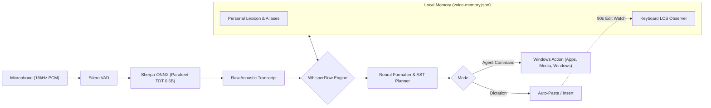

<p align="center">
  
</p>

<p align="center">
  <a href="https://github.com/AbinVarghexe/murmur/releases"></a>
  <a href="https://github.com/AbinVarghexe/murmur/blob/main/LICENSE"></a>
  <a href="https://github.com/sponsors/AbinVarghexe"></a>
  
  
  
</p>

<p align="center">
  <b>Murmur</b> is a local, privacy-first voice dictation and action system for Windows.<br/>
  Powered by an INT8 quantized <b>NeMo Parakeet-TDT-0.6B</b> speech model and a continuous self-learning <b>WhisperFlow</b> personal memory engine with zero cloud latency and zero telemetry.
</p>

---

## Highlights

- **100% Offline & Private:** Audio stays in volatile memory. No audio, transcripts, or personal data ever leaves your computer.
- **Sub-150ms Latency:** Local INT8 quantized Parakeet-TDT-0.6B engine running on CPU via `sherpa-onnx`.
- **WhisperFlow Memory Engine:**
  - **Entity Biasing:** Prevents phonetic hallucinations on technical names (`Antigravity`, `Figma`, `ChatGPT`, user handles).
  - **Zero-Click Keyboard Observation:** Automatically learns phonetic pairs when you edit misheard words with your keyboard within 90 seconds.
  - **Compound Word Normalization:** Resolves token spacing differences (e.g., spoken *"anti gravity"* $\to$ canonical `Antigravity`).
  - **Live Spoken Backtracking:** Real-time speech retraction cues (*"scratch that"*, *"sorry I mean X"*).
- **Agent Action Mode:** Launch desktop applications (including Windows Store Execution Aliases like ChatGPT Desktop), manipulate system volume, media, windows, and search engines.
- **Compact WebGL HUD:** Minimalist $280 \times 48\text{ px}$ floating pill featuring custom WebGL GLSL shaders (`SiriWave`) with active voice harmonics.
- **Modern IDE Studio:** Built using the [Beautiful UI](https://www.beautifului.dev/) design system (React 19 + Tailwind CSS v4) with dark mode and personal lexicon management.

---

## Comparison

| Feature | Cloud Speech APIs (OpenAI Whisper, Google) | Standard OS Dictation (Win+H) | **Murmur v2.0** |
| :--- | :---: | :---: | :---: |
| **Privacy & Locality** | Cloud Dependent (Audio uploaded) | Cloud Dependent | **100% On-Device / Offline** |
| **Response Latency** | 1,200 ms – 3,500 ms | 600 ms – 1,200 ms | **< 150 ms** |
| **WhisperFlow Self-Learning** | ❌ (Static decoder) | ❌ (Static) | **✓ (Continuous keyboard observer)** |
| **Compound Jargon Biasing** | ❌ (Prone to phonetic split) | ❌ | **✓ (Sliding compact windowing)** |
| **System Action Mode** | ❌ (Text only) | Limited | **✓ (AST-based desktop actions)** |
| **Cost / Limits** | Per-minute API billing | Bundled | **Free & Open Source (MIT)** |

---

## Architecture



For the complete technical breakdown, read [docs/ARCHITECTURE.md](docs/ARCHITECTURE.md).

---

## Getting Started

### Installation
Download the latest Windows installer from the [Releases](https://github.com/AbinVarghexe/murmur/releases) page:

- **Installer:** [`Murmur_2.0.0_x64-setup.exe`](https://github.com/AbinVarghexe/murmur/releases/latest)
- **Standalone Portable:** [`murmur.exe`](https://github.com/AbinVarghexe/murmur/releases/latest)

On first run, Murmur loads the offline speech weights (~660 MB) into memory and docks the floating pill HUD.

### Keyboard Shortcuts

| Shortcut | Action | Description |
| :--- | :--- | :--- |
| `Ctrl + Alt + Space` | **Dictate** | Transcribes and types speech directly into focused editor. |
| `Ctrl + Alt + A` | **Voice Command** | Executes agent commands (*"open chatgpt"*, *"volume 50%"*). |
| `Escape` | **Cancel** | Immediately discards current audio recording. |

For hotkey customization and command catalogs, see [docs/USER_GUIDE.md](docs/USER_GUIDE.md).

---

## Local Development

### Requirements
- **Rust:** Stable toolchain (`rustup`)
- **Node.js:** v20+ or v22+
- **LLVM / libclang:** Required for `sherpa-sys` bindgen
- **C++ Tools:** Visual Studio 2022 C++ workload

### Building from Source

```powershell
# Clone repository
git clone https://github.com/AbinVarghexe/murmur.git
cd murmur

# Install dependencies
npm install

# Run test suites (135 Rust unit tests + Vitest)
npm test
cargo test --workspace

# Run Tauri development build
npm run tauri -- dev

# Build production NSIS installer
npm run tauri -- build
```

See [CONTRIBUTING.md](CONTRIBUTING.md) for contribution guidelines.

---

## Sponsoring & Support

If Murmur accelerates your workflow, consider starring the repository and supporting continued open-source development:

- **GitHub Sponsors:** [@AbinVarghexe](https://github.com/sponsors/AbinVarghexe)

---

## License

Murmur is open-source software licensed under the **[MIT License](LICENSE)**.  
Authored by **Abin Varghese** ([@AbinVarghexe](https://github.com/AbinVarghexe)).
